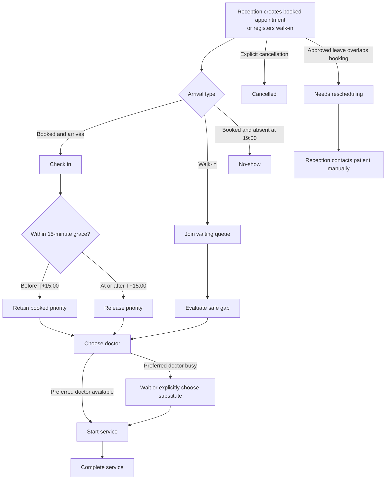

# A0 Appointment and Day-of-Queue Workflow

**Status:** Validated and accepted through A0 review on 2026-11-09  
**Authority:** Accepted A0 business decisions plus approved System/Architecture Design  
**Not production-code approval:** This durable business baseline does not approve prototype implementation for production reuse.

## Purpose

Capture the appointment workflow, state vocabulary, decision rules, and unresolved production questions validated by the receptionist, doctor, and Product Owner through the A0 prototype. Prototype implementation details are not production architecture.

## Validated workflow

## Validated appointment states

| State              | Meaning in A0                                         | Permitted next behavior                                               |
| ------------------ | ----------------------------------------------------- | --------------------------------------------------------------------- |
| `booked`           | Future or current booked appointment with no check-in | check in, cancel, needs rescheduling, or no-show at 19:00             |
| `checked_in`       | Booked patient has arrived                            | wait/start service or cancel                                          |
| `waiting`          | Walk-in or arrived patient waiting for service        | explicitly select doctor/start service or cancel                      |
| `in_progress`      | A doctor has explicitly started service               | complete                                                              |
| `completed`        | Prototype visit finished                              | terminal for A0                                                       |
| `cancelled`        | User/clinic explicitly cancelled                      | terminal and distinct from no-show                                    |
| `no_show`          | Booked patient never checked in by 19:00              | terminal for A0                                                       |
| `needs_reschedule` | Approved leave conflicts with the booking             | reception contacts patient and creates replacement work in production |

## Validated rules

### Grace and waiting order

- T+14:59 remains within the protected grace period.
- At exactly T+15:00, booked priority is released.
- Before T+15:00, an unarrived booking has no late warning.
- At or after T+15:00, an unarrived booking is labelled `Chưa check-in — mất ưu tiên`; `Đến muộn — mất ưu tiên` is reserved for an actual late check-in.
- Once priority is released, arrived patients are ordered by check-in time and then appointment ID for deterministic display.

### Operating date and time context

- The day board always exposes its active operating date.
- Appointment creation defaults to the active operating date.
- Cross-date records display both date and time; a time-only label must not conceal the date used for classification.
- Normal reception cannot create a new appointment earlier than current clinic time, and appointment time must be within clinic operating hours.
- Both UI and backend enforce time validation again when the command is submitted; an input constraint alone is insufficient.
- Immediate arrivals use walk-in intake. Historical migration/backfill, if needed, uses a separate authorized and audited workflow rather than the normal booking form.

### Walk-in safe gaps

- Immediate service is proposed only when estimated duration plus safety buffer finishes before protected booked work.
- Otherwise reception sees the next safe time or a reschedule outcome with a reason.
- Every proposal names the doctor and shows availability, earliest safe start, conflict reason, and the next protected booking used in the calculation.
- With no preference, reception sees a comparison of all doctors. Selecting a preferred doctor highlights that option while keeping labelled alternatives visible.
- The interface offers explicit actions such as start now, wait for a named doctor/time, remain in queue, or propose another appointment; it never assigns a doctor silently.
- Proposal explanations use clinic-facing Vietnamese and recalculate when duration or doctor preference changes.
- The result begins with a plain-language conclusion stating whether any doctor can receive the walk-in now.
- Each option uses local date/time and exposes the service-duration plus safety-buffer calculation; raw implementation terms and ISO timestamps are not an operational explanation.
- The prototype heuristic supports discussion and is not the final scheduling algorithm.

### Doctor preference and substitution

- An explicit requested doctor takes precedence over the recorded primary doctor for this appointment.
- If the preferred doctor is busy, reception sees both waiting and substitute choices where possible.
- A substitute is never assigned silently. Reception may select a substitute for the current visit only after the customer agrees; the decision does not change permanent treatment-course ownership.

### Approved leave

- Approved leave creates doctor unavailability.
- Before approval, admin sees the number and identity of conflicting appointments and acknowledges responsibility for resolution; a necessary leave is warned rather than absolutely blocked.
- Overlapping booked appointments are preserved and marked `needs_reschedule`.
- Approval immediately creates owned manual-contact tasks for reception. Each task records deadline/urgency, attempts, operator, result, unresolved age, and escalation to admin.
- If approved during working hours, first contact is due within two working hours. After-hours approval is due before 10:00 next working day. An affected appointment within 24 hours is urgent and requires immediate action.
- Emergency leave uses an explicit exception path with a mandatory reason.
- Reception performs patient contact manually; A0 sends no external messages.

### Cancellation and no-show

- Cancellation requires an explicit action and remains `cancelled`.
- At 19:00, only unarrived booked appointments become `no_show`.
- Checked-in, waiting, in-progress, completed, cancelled, and walk-in records are not converted to no-show.
- The 19:00 no-show sweep is not final operational day closure. Its action label must describe the no-show processing rather than imply all work is closed.
- Checked-in, waiting, or in-progress patients may continue after 19:00 and appear in an end-of-day exception list with owner and next action.
- Final day closure is separate and requires every active exception to be resolved or explicitly acknowledged by an authorized user.
- `booked` shows no warning before T+15 and an absent-priority warning afterward. `checked_in`/`waiting` may show arrival classification while queue-relevant.
- `in_progress`, `completed`, `cancelled`, `no_show`, and `needs_reschedule` suppress all grace/late-priority messages; non-queue or terminal status has display precedence.

## Explicit A0 exclusions

- Real identity, authentication, authorization, API, database, concurrency, audit, jobs, and messaging integrations.
- Real patient identifiers or clinical information.
- Production-ready service-duration, safe-gap, leave-policy, or queue algorithms.
- Automatic contact attempts or permanent doctor-course reassignment.

## SME review questions used

1. Can reception understand the board and complete each scenario without facilitator intervention?
2. Are the status labels and action names consistent with actual clinic language?
3. Does the safe-gap explanation provide enough information for reception to make a decision?
4. Does the doctor agree that wait/substitute choices preserve clinical continuity?
5. Is the rescheduling list sufficient for manual follow-up after approved leave?
6. Are cancellation and no-show visibly and operationally distinct?
7. Which additional exception paths must enter the production Plan 2 backlog?

## Evidence and approval

- Fixed scenarios: [`a0-appointment-acceptance-scenarios.md`](./a0-appointment-acceptance-scenarios.md)
- Review record: [`../reviews/a0-appointment-prototype-review.md`](../reviews/a0-appointment-prototype-review.md)
- Screenshot/recording references: none retained; the live session used fake labels only
- Accepted findings and Product Owner decision: F-001 through F-007 accepted on 2026-11-09 in the linked review record
